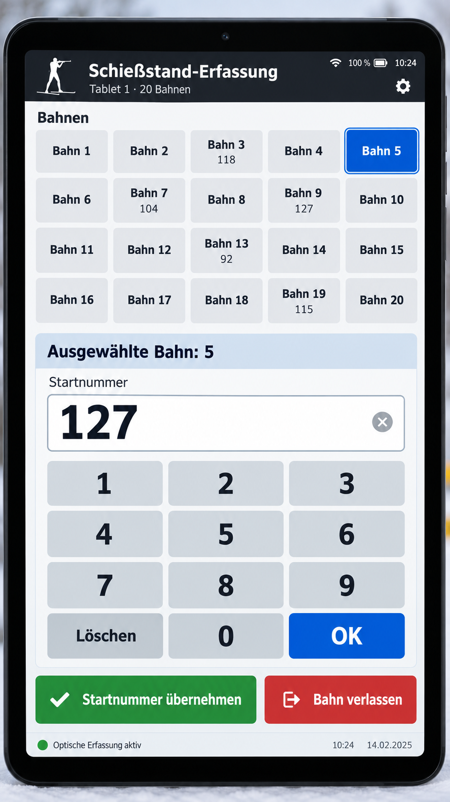
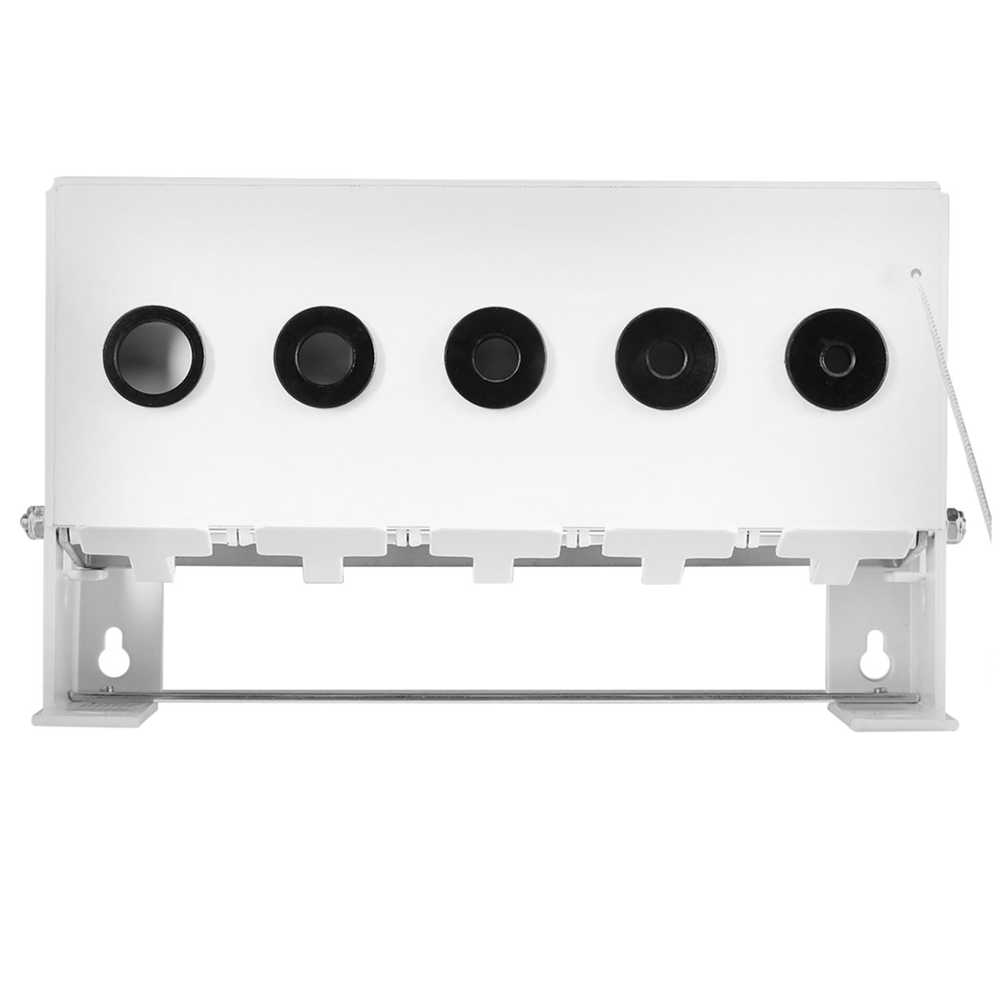
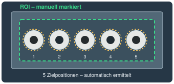

# Biathlon Target Vision

**Herstellerunabhängige Live-Erfassung von Bahnbelegung, Startnummern und
Klappscheibenzuständen für mechanische Biathlon-Schießstände.**

Biathlon Target Vision ist ein lokal betreibbares Open-Source-System für Vereine,
Veranstalter, Kampfrichter und Systemintegratoren. Der Schwerpunkt liegt auf
temporären 10-Meter-Luftgewehr-Schießständen bei Schülercups,
Nachwuchswettkämpfen, Trainingsveranstaltungen und Gästeschießen.

Kampfrichter erfassen die Bahnbelegung über Tablets. Ziel ist, vorhandene
mechanische Anlagen durch Kameras oder Sensoren zu ergänzen und die erfassten
Daten über dokumentierte Schnittstellen an externe Zeitnahme- und Anzeigesysteme
weiterzugeben. Version 0.6 bietet Tablet-Bedienung, Kontrollmonitor, Installation, RTSP-Kameras,
optische Zielzustände und Simulator. Die Erkennung ist bislang synthetisch geprüft;
reale Schießstandaufnahmen fehlen.

## Projektumfang und Abgrenzung

Biathlon Target Vision erfasst Schießstanddaten live und stellt sie über
dokumentierte Schnittstellen bereit. Es ist **kein Wettkampf-, Zeitnahme- oder
Ergebnisverwaltungssystem**.

Wesentliche Grundsätze:

- Zuverlässige Erfassung von Bahnbelegung, Startnummer und Klappscheibenzuständen.
- Einfache Bedienung durch eingewiesene Kampfrichter.
- Klare Zuordnung einer begrenzten Anzahl von Bahnen je Tablet; die Auswahl darf
  sich zwischen Tablets überschneiden und kann auch alle Bahnen umfassen.
- Unkomplizierte Korrektur falscher Startnummerneingaben und Ereignisspeicherung.
- Mehrere Bedienplätze mit synchronisierten Daten, ohne exklusive Bahnsperren.
- Live-Datenausgabe für externe Zeitnahme- und Anzeigesysteme.
- Keine unnötige Absicherung gegen jede theoretisch denkbare Fehlbedienung.

Ergebnisberechnung, Strafzeiten- oder Strafrundenverwaltung, offizielle
Ergebnislisten und umfangreiche nachträgliche Ergebniskorrekturen gehören zum
angeschlossenen Zeitnahme- beziehungsweise Ergebnissystem. Die einfache
Eingabekorrektur und die Ereignisspeicherung bleiben Teil dieses Projekts.

## Aktueller Stand: Version 0.6

### Implementiert

- Dokumentierter REST-/WebSocket-Vertrag für externe Anwendungen, einschließlich
  Serverneustart-Erkennung und Erfassungsstatus. BTV liefert Zielzustände und
  erzeugt keine KES-, Schuss- oder Fehlschussmeldungen.

- Laufende optische Auswertung kalibrierter dunkler Öffnungen und heller Klappen,
  zeitlich bestätigte Zielzustände, Rückstellungen und unbekannte Zustände bei
  unklarer Sicht oder Kameraausfall. Bislang ausschließlich synthetisch validiert.

- Mehrere RTSP-Kameras unter `/admin` verwalten, Livebild prüfen, mehrere Bahnen
  je Kamera zuordnen und die Gesamt-ROI je Bahn automatisch kalibrieren.

- Schreibgeschützter Kontrollmonitor unter `/monitor`, einschließlich erkannter
  gefallener Ziele je aktueller Einlage.
- Debian-/Ubuntu-Installation mit systemd sowie Version, Status und Upgrade.

- Standardmäßig 20 Schießbahnen, Anzahl konfigurierbar.
- Browserbasierte Tablet-Bedienung im Hoch- und Querformat mit großen,
  kontrastreichen Bedienelementen und numerischem Tastenfeld.
- Startnummern zuordnen und korrigieren, Bahnen freigeben, Einlagen einsehen.
  Auch eine verspätete Zuordnung zu einer Schießeinlage ist möglich.
- Fünf unabhängige Zielzustände je Bahn: aufgerichtet, gefallen oder unbekannt.
- Mehrere synchronisierte Bedienplätze mit lokaler Bahn- und Sprachauswahl:
  English als Standard, Deutsch und Čeština auswählbar.
- Getrennte, live sichtbare unbestätigte Eingaben je Bedienplatz. Treffer und
  Rückstellungen unterbrechen die Startnummerneingabe nicht. Bei Verbindungsverlust
  bleibt der offene Text erhalten; bestätigt werden kann erst wieder online.
- Simulationsbetrieb ohne Kameras, lokale Ereignisspeicherung und
  Wiederherstellung nach Neustart sowie REST-API und WebSockets.
- Standbild-Kalibrierung: gesamten Scheibenbereich markieren, fünf Zielbereiche
  automatisch erkennen, kontrollieren und speichern; kleine Bildverschiebungen
  nachführen. Die Zuverlässigkeit an echten mechanischen Anlagen ist noch offen.

### Geplante Erweiterungen

- **Sensorerfassung:** Fünf Sensoren je Bahn mit ESP32 und WLAN. Bevorzugt werden
  Hall-Sensoren mit Magneten untersucht; Reedkontakte oder mechanische Schalter
  sind Alternativen. Befestigung und Wetterschutz richten sich nach der Anlage.
  Kamera- und Sensorerfassung sollen gemeinsam einsetzbar sein.
- **Physisches Tastenfeld:** Bahn auswählen, Startnummer eingeben, bestätigen
  und korrigieren sowie freigeben; als Alternative bei Kälte oder Handschuhen.
  Es soll dieselbe zentrale Bahnverwaltung wie die Tablets nutzen.
- **GFX-Anbindung:** Ein eigenständiger BTV-Adapter in gfx-engine wird separat in
  [Issue #102](https://github.com/richtertoralf/gfx-engine/issues/102) verfolgt.
- **Betrieb und Validierung:** Praxistests mit realen mechanischen Anlagen und Tablets.

Der weitere Ausbau konzentriert sich auf optische Erfassung, deren Integration
mit dem Ereigniskern, externe Integration und Praxistests. Physische Tastenfelder und
ESP32-Sensoradapter sind anschließende Erweiterungen.

## Bedienung am Schießstand

Je Tablet beispielsweise drei bis fünf Bahnen auswählen. Eine Bahn öffnen,
die Startnummer über das Zahlentastenfeld eingeben und ausdrücklich bestätigen.
Eine falsche Startnummer kann korrigiert werden; beim Verlassen des Schießstandes
die Belegung freigeben. Bei widersprüchlichen bestätigten Eingaben zeigt der
Dialog den Konflikt an und erhält den eigenen Text zur Prüfung.

Zielbeobachtungen bleiben auch ohne Startnummer erhalten. Eine Rückstellung
beendet die Einlage, ersetzt aber nicht die Bahnfreigabe. Eine verspätete
Freigabe darf die nächste Einlage nicht dem vorherigen Sportler zuordnen.
Aus Klappscheibenzuständen werden keine Schuss- oder Fehlschusszeitpunkte erfunden.



Mechanische Luftgewehranlage und Kalibrierungskonzept:





## Unter Debian/Ubuntu installieren

Voraussetzung: Debian/Ubuntu mit Python 3.11 oder neuer, systemd und Internet
für die Installation. Installation des veröffentlichten Stands:

```bash
git clone https://github.com/richtertoralf/biathlon-target-vision.git
cd biathlon-target-vision
git checkout v0.6.0
./install.sh
```

Der Installer nutzt bei Bedarf sudo. Der Dienst startet automatisch als Benutzer
`btv`. Tablet: `http://SERVER-IP:8091/`, Monitor: `http://SERVER-IP:8091/monitor`.

```bash
biathlon-target-vision --version
biathlon-target-vision --status
sudo biathlon-target-vision --upgrade
```

Upgrades verwenden den neuesten veröffentlichten Versionstag und erhalten
Konfiguration, Kalibrierungen und Ereignisse. Betrieb und Speicherorte beschreibt
[ARCHITECTURE.md](docs/ARCHITECTURE.md#installation-und-upgrades).

## Lokal installieren und starten

Voraussetzung: Linux, Python 3.11 oder neuer und `python3-venv`.
Im Repository-Verzeichnis:

```bash
python3 -m venv .venv
.venv/bin/python -m pip install -r requirements.txt
.venv/bin/python -m biathlon_target_vision
```

Tablet-Bedienung: <http://127.0.0.1:8091/> ·
Kalibrierung: <http://127.0.0.1:8091/calibration> ·
Interaktive API: <http://127.0.0.1:8091/docs>

Für den Zugriff im lokalen Netz `--host 0.0.0.0` ergänzen und auf den Tablets
`http://SERVER-IP:8091/` öffnen. Sprache und Bahnauswahl bleiben je Browser und
Serveradresse gespeichert. Die Anwendung benötigt im Betrieb keine Cloud und
keinen Internetzugang; sie ist ohne Anmeldung für ein vertrauenswürdiges lokales
Netz ausgelegt.

Beispiel mit anderer Bahnanzahl, Port und eigenem Datenordner:

```bash
.venv/bin/python -m biathlon_target_vision --lanes 8 --port 8092 --data-dir data-test
```

Die Bahnanzahl wird beim ersten Start gespeichert. Für eine andere Anzahl einen
neuen Datenordner verwenden. Genau einen Serverprozess je Datenordner betreiben.

## Kameras einrichten

`http://SERVER-IP:8091/admin` öffnen. Kennung, Name, vollständige RTSP-Adresse
(zum Beispiel `rtsp://192.168.95.43/1/h264major`) und Bahnnummern eintragen.
Jede Bahn besitzt zunächst genau eine Kamera. Die Vorschau zeigt aktuelle Bilder;
bei Verbindungsproblemen wird automatisch erneut verbunden.

Über „Bahn … kalibrieren“ das aktuelle Kamerabild übernehmen und vier Ecken um den
gesamten Scheibenbereich markieren. Die fünf automatisch gefundenen Umrisse
kontrollieren. Bei Kamera-/Adresswechsel, anderer Auflösung oder geänderter
Ausrichtung neu kalibrieren. Die Auswertung startet nach gültiger Kalibrierung
selbstständig. Erste Bilder nach Start/Verbindungsausfall liefern Grundzustände;
sie erzeugen keine rückwirkenden Treffer. Die aktuelle Zielanzeige und die Zahl
beobachteter Fälle während einer Einlage können deshalb voneinander abweichen.
Bei fehlenden Endkonturen oder zu großer Bewegung werden alle Ziele unbekannt.
Beim Bearbeiten bleibt eine leer gelassene RTSP-Adresse
erhalten; gespeicherte Zugangsdaten werden nicht an den Browser zurückgegeben.

## Externe Anwendungen

Aktueller Zustand: `http://SERVER-IP:8091/api/state`, laufende vollständige Zustände:
`ws://SERVER-IP:8091/ws`. Beide verwenden denselben Web-Port wie die Tablets.
Der [Integrationsvertrag](docs/API.md#externe-integration-eigenständige-quelle-btv)
beschreibt Zielzustände, Einlagen, Belegung, Unterbrechungen und ein lesendes Beispiel.
BTV bildet eine eigenständige Quelle; bestehende KES-/HORA-Empfänger werden dadurch
nicht ersetzt oder verändert.

## Simulationsbetrieb

Für Übungen mit einem separaten Datenordner starten:

```bash
.venv/bin/python -m biathlon_target_vision --simulation --data-dir data-simulation --host 0.0.0.0
```

Im gekennzeichneten Simulationsmodus ein Ziel antippen und seinen Zustand ändern.
„Simulation: alle aufrichten“ stellt alle fünf Ziele zurück. Zum Durchspielen:
Treffer vor der Startnummerneingabe auslösen, die Nummer zuordnen, Ziele
zurückstellen, die Belegung freigeben und die nächste Einlage beginnen.
Abgeschlossene Einlagen können unter „Einlagen“ nachträglich zugeordnet werden.

Ohne `--simulation` sind die Simulationsfunktionen deaktiviert. Übungen werden
regulär gespeichert; Training und Wettkampf deshalb in getrennten Datenordnern
betreiben. Den Simulator für die Kommandozeile beschreibt die
[API-Dokumentation](docs/API.md#simulator-für-die-kommandozeile).

## Weiterführende Dokumentation

- [Architektur](docs/ARCHITECTURE.md): aktuelle Komponenten, Datenfluss und technische Entscheidungen.
- [API und Integration](docs/API.md): Schnittstellen, Zuordnungsregeln und Integrationshinweise.
- [Entwicklungsbericht](docs/ENTWICKLUNGSBERICHT.md): Entscheidungen, bisherige Testergebnisse, Prüfaufrufe und bekannte Einschränkungen.
