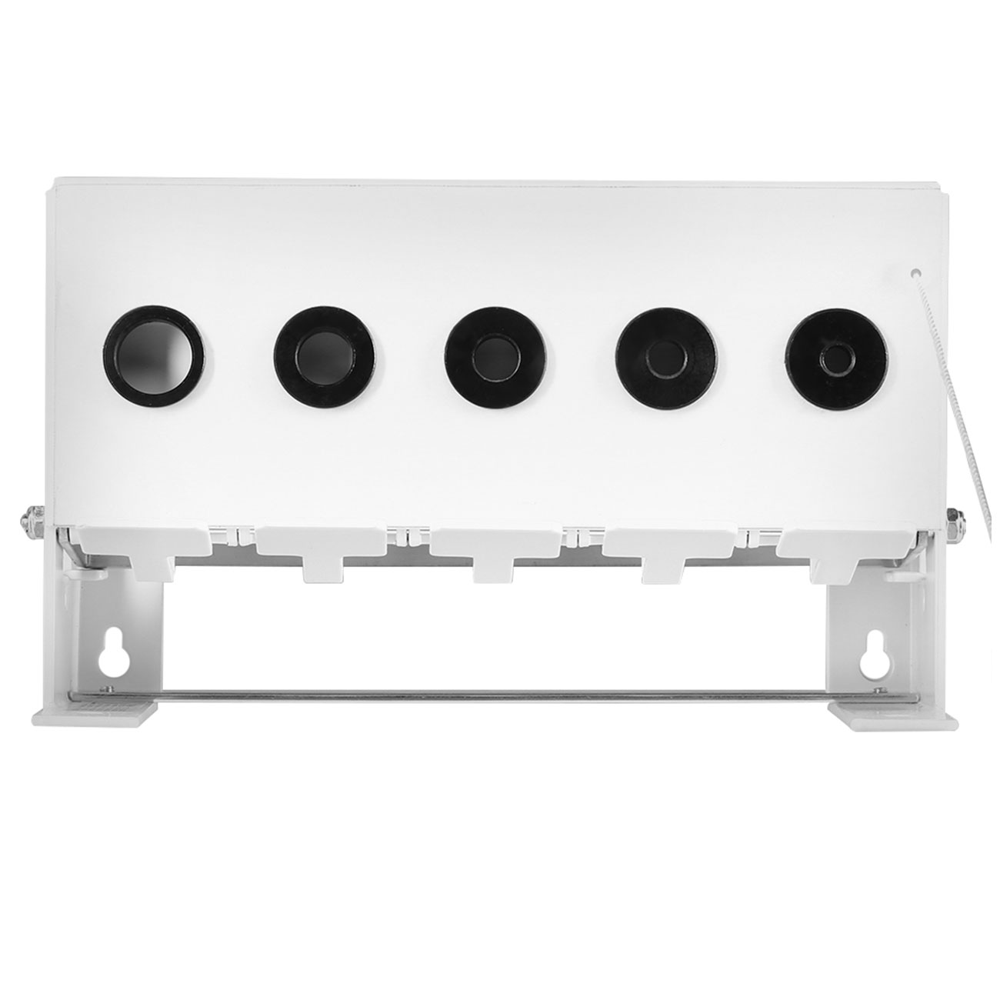

# Bedienungsanleitung

Ausführliche Bedienung von Biathlon Target Vision. Installation, Kurzanleitung und
Deinstallation stehen in der [README](../README.md), Schnittstellen in [API.md](API.md).

## Ein Ablauf – mit oder ohne Kamera

Der Kampfrichter bedient immer dieselben Bahnkacheln. Ohne Kameras erfasst er die
fünf Scheiben selbst; eine zugeordnete Kamera liefert ihre Beobachtungen automatisch.
**Jede Scheibe bleibt jederzeit direkt korrigierbar. Menschliche Eingaben haben
Vorrang**, während die anderen Scheiben weiter automatisch erfasst werden. Es gibt
keine Betriebsartwahl am Tablet.

Versorgt eine Kamera beispielsweise die **Bahnen 4 bis 6** und fällt aus oder
liefert wegen Schneefalls keine zuverlässigen Beobachtungen mehr, erfassen die
Kampfrichter dort unmittelbar nach Sicht weiter. Kein Umschalten ist erforderlich;
Startnummern, laufende Schießeinlagen und Ereignisse bleiben erhalten. Andere
Bahnen arbeiten unabhängig weiter. Auch nach Wiederverbindung bleiben einzelne
Korrekturen geschützt. Sie enden mit bestätigter vollständiger Rückstellung oder
einer neuen Schießeinlage. Erste Kamerabilder nach einer Unterbrechung sind
Grundbeobachtungen und erzeugen keine rückwirkenden Fälle oder Rückstellungen.

**Sensorik ist geplant:** Manuelle Erfassung und Kameraerfassung sind vorhanden.
Sensorhardware und Sensoradapter sind noch nicht implementiert. Auch spätere
Sensordaten sollen im Hintergrund helfen und menschlichen Korrekturen unterliegen.
Quellenzuordnung und technische Einstellungen gehören in die Administration.

## Ablauf für Kampfrichter am Schießstand


Die Kamera erfasst ausschließlich Scheibenzustände und zuverlässig beobachtete
vollständige Rückstellungen. Betreten, Startnummer, Beaufsichtigung und Verlassen
bleiben Aufgaben der Kampfrichter. Die mechanischen Scheiben müssen tatsächlich
aufgerichtet werden; eine Schaltfläche bewegt sie nicht.

0. **Bahn frei und vorbereitet:** Kein Sportler auf der Bahn, alle fünf Scheiben
   tatsächlich aufgerichtet und die Vorbereitung bestätigt. Die Kachel ist
   **grün: „Frei – bereit“**. Ein unbekannter Ausgangszustand gilt noch nicht als bereit.
1. **Sportler betritt die Bahn:** **„Bahn belegen“** antippen. Die Kachel wird sofort
   **gelb: „Belegt“**, auch ohne bekannte Startnummer. Die Kamera entscheidet nicht
   über Betreten oder Verlassen einer Bahn.
2. **Startnummer erfassen:** Neben „Startnummer“ auf **„Eingeben“** tippen, die BIB
   über das Zahlentastenfeld eingeben und bestätigen. Die Nummer erscheint groß
   auf allen verbundenen Tablets. Verspätete Eingabe und Korrektur bleiben möglich.
3. **Schießeinlage verfolgen:** **Schwarz bedeutet aufgerichtet, weiß bedeutet
   gefallen.** Die Kamera aktualisiert automatisch, soweit vorhanden. Fehlt sie
   oder stimmt eine Anzeige nicht, die betreffende Scheibe antippen: Schwarz wird
   weiß, erneutes Antippen korrigiert die Eingabe. Bei **„?“** öffnet Antippen die
   eindeutige Auswahl **„Aufgerichtet“ / „Gefallen“**. Eine Einzelkorrektur beginnt
   oder beendet keine Einlage und wird nicht durch unveränderte Kamerabilder
   überschrieben.
4. **Sportler verlässt die Bahn:** **„Bahn verlassen“** antippen. Die Belegung endet;
   Scheibenstellungen bleiben erhalten. Fehlt die bestätigte Rückstellung, ist die
   Kachel **grau: „Frei – Rückstellung ausstehend“**.
5. **Mechanisch zurückstellen:** Die Scheiben tatsächlich aufrichten, etwa durch
   Ziehen am Seil, dann **„Alle Scheiben aufgerichtet“** bestätigen. Diese Aktion ist
   immer sichtbar und funktioniert auch ohne Kamera. Alternativ kann eine Kamera
   eine zuverlässig beobachtete vollständige Rückstellung bestätigen. Ist die
   Bahn nicht mehr belegt, wechselt die Kachel auf Grün.

| Kachel | Bedeutung | Nächste Aufgabe |
|---|---|---|
| **Grün – Frei, bereit** | Unbelegt, alle Scheiben aufgerichtet, Vorbereitung bestätigt | Nächsten Sportler mit „Bahn belegen“ erfassen |
| **Gelb – Belegt** | Sportler auf der Bahn, unabhängig von Scheibenstellungen | BIB und Scheiben beaufsichtigen, dann „Bahn verlassen“ |
| **Grau – Frei, Rückstellung ausstehend** | Unbelegt, Vorbereitung fehlt oder Scheiben gefallen/unbekannt | Mechanisch zurückstellen und bestätigen |

Bahnverlassen und Rückstellung dürfen in umgekehrter Reihenfolge erfolgen:
Eine Rückstellung gibt eine belegte Bahn nicht frei. Fünf unverändert aufgerichtete
Scheiben beweisen keine neue Rückstellung, etwa nach einer Einlage ohne gefallene
Scheibe oder nach Kameraneustart. Dann die tatsächliche Vorbereitung ausdrücklich
bestätigen. Unsichere Kameradaten machen eine Bahn nicht automatisch bereit;
eine menschliche Rückstellbestätigung gilt auch bei ausgefallener Kamera.

Unter **„Optionen“** liegt die Einlagenhistorie für verspätete BIB-Zuordnungen.
Jede Bahnkachel zeigt außerdem **„Automatik aktiv“**, **„Erkennung läuft / unsicher“**
oder **„Nur manuell“**. Erst bestätigte Kamerabeobachtungen aller fünf Scheiben
ergeben „Automatik aktiv“; eine verbundene Kamera allein genügt nicht. Bei fehlender
oder unsicherer Erfassung nach Sicht eingeben. Einzelne manuelle Korrekturen sind
mit **„Manuell“** an der Scheibe gekennzeichnet und behalten Vorrang. Bei getrennter
Serververbindung ist auch der Erfassungsstatus unbekannt; Eingaben sind dann gesperrt.

Je Tablet die betreuten Bahnen auswählen; Auswahlen dürfen sich überschneiden.
Andere Tablets zeigen unbestätigte Startnummerneingaben getrennt vom verbindlichen
Stand. Bei einem Belegungskonflikt bleibt die eigene Eingabe zur Prüfung erhalten.

Der Jury-/Kontrollmonitor unter `/monitor` zeigt alle Bahnen schreibgeschützt mit
denselben drei Hintergrundfarben, bestätigter Startnummer und fünf wirksamen
Scheibenstellungen. Hinweise auf unzuverlässige Erfassung fordern zur Sichtprüfung
auf. Technische Vergleichswerte und Quellenverwaltung stehen unter `/admin`.

## Aufzeichnungssitzungen

Unter `/admin` lässt sich die aktuelle Sitzung benennen und mit **„Sitzung
abschließen und neue starten“** beenden. Den Namen der nächsten Sitzung eingeben
und den Abschluss ausdrücklich bestätigen. Die Seite warnt vor noch belegten
Bahnen oder offenen Schießeinlagen. Ein bestätigter Abschluss archiviert den
bisherigen Stand; er behauptet keine mechanische Rückstellung und kein Verlassen.

Die neue Sitzung hat keine Startnummern, Belegungen oder Schießeinlagen. Alle
Bahnen beginnen grau und müssen erneut vorbereitet werden. Tablets und Monitor
wechseln automatisch; offene Eingaben aus der alten Sitzung werden geschlossen.
Die Kameras, Bahnzuordnungen, Kalibrierungen und administrativen Quellensperren
bleiben erhalten. Erste Kamerabilder sind Grundbeobachtungen, keine rückwirkenden
Fälle oder Rückstellungen. Identische BIBs in verschiedenen Sitzungen sind unabhängig.

Journal und Korrekturbelege bleiben je Sitzung unter `sessions/SITZUNGS-ID/` im
Datenordner erhalten. Abgeschlossene Sitzungen sind in der Administration mit
ihrer Journal-API verlinkt; eine zeitbezogene Journalansicht und Exportoberfläche
sind weiterhin geplant. Archive werden nicht automatisch gelöscht. Neustarts
setzen die aktive Sitzung fort. Die Administration setzt derzeit weiterhin ein
vertrauenswürdiges lokales Netz voraus; Benutzerrollen sind noch nicht umgesetzt.

**Einmaliger Wechsel alter Testinstallationen:** Alte Stände speicherten direkt
`events.jsonl` und `corrections/` im Datenordner. Dieser Bestand wird weder
umgeschrieben noch gelöscht; der neue Server verlangt vorherige manuelle
Archivierung. Server stoppen, den vollständigen bisherigen Datenordner unter
einem eindeutig benannten Archivpfad aufbewahren und einen neuen Datenordner
anlegen. Nur `config.json` und `calibrations/`, soweit vorhanden, aus der Sicherung
kopieren. Bei systemd liegt der Datenordner unter `/var/lib/biathlon-target-vision`;
Eigentümer `btv:btv`, Verzeichnisrechte `0750`, Konfigurationsrechte `0600` und
Schreibrechte des Dienstbenutzers auch für kopierte Kalibrierungen wiederherstellen.
Lokal kann stattdessen ein neuer `--data-dir` verwendet werden. Administrative
Quellensperren aus dem alten Journal bei Bedarf erneut setzen.

Bisher benötigte jede neue Veranstaltung einen eigenen Datenordner und einen
Serverneustart. Für neu angelegte Sitzungen entfällt das. Ältere
Entwicklungsversionen und API-Schreiber ohne Sitzungskennung werden nicht
unterstützt; siehe [Sitzungsvertrag](API.md#aufzeichnungssitzungen-api-version-2).
Keinen älteren Programmstand mit dem neuen Datenordner betreiben. Für einen
bewussten Rückwechsel den separat aufbewahrten alten Testbestand verwenden.

Für Praxistests gibt es unter `/admin#sessions` zusätzlich Feldprotokoll (PDF),
Testdiagnose und automatisches Testprotokoll; Ablauf und Grenzen beschreibt
[ARBER-TESTPROTOKOLL.md](ARBER-TESTPROTOKOLL.md).

## Konfiguration

### Überblick

BTV braucht wenig Konfiguration: Serveradresse und Port, optional Kameras mit
Bahnzuordnung und je Bahn eine Kalibrierung. Die Bahnanzahl legt der erste Start
eines Datenordners fest. Weitere Einstellungen gibt es nicht; insbesondere keine
Umgebungsvariablen für den Betrieb.

### Speicherorte

Bei der systemd-Installation ist der Datenordner `/var/lib/biathlon-target-vision`,
beim lokalen Start der mit `--data-dir` angegebene Ordner (Standard: `data`).

| Pfad | Inhalt | Schreibt |
|---|---|---|
| `<Datenordner>/config.json` | `host`, `port`, `cameras` | Installer (Erstanlage mit `host` und `port`), Administration (Kameras), Betreiber |
| `<Datenordner>/calibrations/lane-N.json` | Kalibrierung je Bahn, gebunden an Kamerakennung und Adresse | Kalibrierungsseite |
| `<Datenordner>/sessions.json`, `sessions/SITZUNGS-ID/` | aktive und archivierte Sitzungen; die erste Journalzeile enthält die Bahnanzahl | BTV |
| `/etc/systemd/system/biathlon-target-vision.service` | Dienst; startet mit `--data-dir /var/lib/biathlon-target-vision` | Installer |
| `/etc/systemd/system/biathlon-target-vision.service.d/` | optionale Ergänzungen, etwa `--lanes` | Betreiber (`systemctl edit`) |
| `/opt/biathlon-target-vision/backups/` | Sicherung des Datenordners bei jedem Upgrade | Upgrade |

Administrative Quellensperren stehen im Ereignisjournal und bleiben über Neustarts
und Sitzungswechsel erhalten.

### Einstellungen

| Name | Ort | Bedeutung | Zulässige Werte | Standard |
|---|---|---|---|---|
| `host` | `config.json` | Adresse, an die der Server bindet | Adresse; `0.0.0.0` = im lokalen Netz erreichbar | `127.0.0.1`; die Installation schreibt `0.0.0.0` |
| `port` | `config.json` | HTTP-Port | Ganzzahl 1–65535 | 8091 |
| `cameras[].id` | `config.json` | feste Kennung; Kalibrierungen sind daran gebunden | 1–64 Zeichen `a-z A-Z 0-9 _ -`, eindeutig, nach dem Anlegen nicht änderbar | – |
| `cameras[].name` | `config.json` | Anzeigename | 1–128 Zeichen | – |
| `cameras[].url` | `config.json` | vollständige RTSP-Adresse, ggf. mit Zugangsdaten | `rtsp://` oder `rtsps://` mit Host, ohne Leerzeichen | – |
| `cameras[].lane_ids` | `config.json` | Bahnen dieser Kamera | eindeutige Bahnnummern ≥ 1, höchstens die Bahnanzahl; jede Bahn höchstens einer Kamera | leer |
| `--host`, `--port` | Startoption | überschreiben `host` und `port` | wie oben | – |
| `--lanes` | Startoption | Bahnanzahl eines neuen Datenordners | Ganzzahl ≥ 1 | 20 |
| `--data-dir` | Startoption | Datenordner | Pfad | `data`; Dienst: `/var/lib/biathlon-target-vision` |
| `--simulation` | Startoption | gekennzeichneter Simulationsbetrieb mit Übungsdialogen und der Quelle `simulator` | Schalter | aus |

Unbekannte Einträge in `config.json` werden abgelehnt.

### Prioritäten

- Adresse und Port: Startoption vor `config.json` vor Standard (`127.0.0.1:8091`).
  Der Dienst setzt keine dieser Optionen; fehlt `config.json`, bindet er nur lokal.
- Bahnanzahl: Die im Journal gespeicherte Zahl gilt. `--lanes` wirkt nur beim ersten
  Start eines Datenordners; eine abweichende Angabe bei vorhandenem Journal verhindert
  den Start. Neue Sitzungen übernehmen die bisherige Bahnanzahl.

### Einrichtung und Änderung

- **Kameras und Bahnzuordnung:** in der Administration, siehe
  [Kameras einrichten](#kameras-einrichten). Die Administration schreibt `config.json`
  vollständig neu.
- **Adresse und Port:** Dienst stoppen, `config.json` mit `sudoedit` bearbeiten,
  Dienst starten. Eigentümer `btv:btv` und Rechte `0600` müssen erhalten bleiben. Bei
  laufendem Dienst nicht von Hand ändern: Er liest die Datei nur beim Start, und die
  nächste Kameraänderung in der Administration überschreibt die Datei mit seinem Stand.
- **Bahnanzahl des Dienstes:** am besten vor dem ersten Start festlegen. Mit
  `sudo systemctl edit biathlon-target-vision` die Startzeile ergänzen:

  ```ini
  [Service]
  ExecStart=
  ExecStart=/opt/biathlon-target-vision/current/.venv/bin/python -m biathlon_target_vision --data-dir /var/lib/biathlon-target-vision --lanes 24
  ```

  Gibt es schon Sitzungen, startet der Dienst mit einer anderen Zahl nicht. Dann den
  Datenordner vollständig sichern und `sessions.json` sowie `sessions/` entfernen;
  `config.json` und `calibrations/` können bleiben. Kameras dürfen keine Bahn über der
  neuen Anzahl zugeordnet haben. Die Ergänzung bleibt bei Upgrades erhalten.
- **Neue Veranstaltung:** Sitzungswechsel unter `/admin`; Kameras, Bahnzuordnungen,
  Kalibrierungen und Quellensperren bleiben ([Aufzeichnungssitzungen](#aufzeichnungssitzungen)).

### Wirksamkeit

| Änderung | Wirkung |
|---|---|
| Kamera anlegen, ändern, entfernen (Administration) | sofort |
| Kalibrierung | sofort |
| `host`, `port`, Kameras von Hand in `config.json` | nach Neustart |
| `--lanes`, `--simulation`, `--host`, `--port` | nach Neustart; `--lanes` nur für einen neuen Datenordner |

### Geheimnisse und Berechtigungen

`cameras[].url` kann Benutzername und Passwort der Kamera enthalten. `config.json` hat
die Rechte `0600` (Eigentümer `btv`), der Datenordner `0750`; der Dienst legt neue
Dateien nur für sich lesbar an. Administration, Testprotokoll und `--status` zeigen
Kameraadressen höchstens ohne Zugangsdaten und Abfrageparameter; Fehlermeldungen
enthalten keine Adresse, Decoderlogs sind abgeschaltet. Die Sicherungen unter
`/opt/biathlon-target-vision/backups/` enthalten `config.json` mit den Zugangsdaten
und werden nicht automatisch gelöscht; eine Begrenzung ist geplant
([#58](https://github.com/richtertoralf/biathlon-target-vision/issues/58)).

Bekannte Grenze: Administration und Kamera-Schnittstellen haben noch keine Anmeldung;
BTV setzt ein vertrauenswürdiges lokales Netz voraus. Ein Zugriffsschutz ist noch
nicht vorhanden ([#24](https://github.com/richtertoralf/biathlon-target-vision/issues/24)).

### Installation, Aktualisierung, Entfernen

| Vorgang | Wirkung auf die Konfiguration |
|---|---|
| Erstinstallation (`./install.sh`) | legt `config.json` mit `host: 0.0.0.0` und `port: 8091` an |
| erneutes `./install.sh` | `config.json` bleibt; Rechte werden auf `0600`/`btv` gesetzt; Ergänzungen unter `.service.d/` bleiben |
| `--upgrade` | sichert vor dem Umschalten den gesamten Datenordner; Konfiguration, Kalibrierungen und Sitzungen bleiben. `config.json` wird vorher nicht mit der neuen Version geprüft: Startet ein zuvor laufender Dienst mit der neuen Version deshalb nicht, läuft wieder der vorherige Programmstand |
| Entfernen | nur von Hand nach [README](../README.md#deinstallation); eigene Befehle `--uninstall`/`--purge` und ein Prüfbefehl sind noch nicht vorhanden ([#60](https://github.com/richtertoralf/biathlon-target-vision/issues/60)) |

### Prüfung und Fehlerdiagnose

- `sudo biathlon-target-vision --status` zeigt Serveradresse mit Herkunft (aus
  `config.json` oder Aufrufparametern), Datenverzeichnis, Bahnen, Kameras mit
  Verbindungsstatus, Kalibrierung und Sitzung ([Status und Upgrade](#status-und-upgrade-der-systemd-installation)).
  Exitcode `2`: `config.json` lesbar, aber ungültig. Ohne sudo ist die Datei nicht
  lesbar; das ist nur ein Hinweis.
- Ungültige `config.json`: Der Dienst startet nicht; das Journal
  (`journalctl -u biathlon-target-vision`) meldet allgemein „Ungültige config.json“
  ohne Kameraadresse. Dann Felder und eindeutige Bahnzuordnung prüfen.
- Ob der Simulationsbetrieb aktiv ist, zeigt `/api/state` (`simulation`); `--status`
  zeigt es nicht.

## Kameras einrichten

`http://SERVER-IP:8091/admin` öffnen. Die Administration hat drei Bereiche:
**Kameras**, **Bahnen** und **Sitzungen**. Unter „Kameras“ → „Neue Kamera anlegen“
Name, vollständige RTSP-Adresse (zum Beispiel `rtsp://KAMERA-IP:554/STREAMPFAD`)
eintragen und die Bahnen antippen. Die Kennung wird aus dem Namen vorgeschlagen und
bleibt danach fest. Mehrere Bahnen können dasselbe Kamerabild nutzen; jede
automatisch erfasste Bahn hat genau eine zuständige Kamera. Bei
Verbindungsproblemen wird erneut verbunden.

Über „Bahn … kalibrieren“ das aktuelle Kamerabild übernehmen und vier Ecken um
den gesamten Scheibenbereich markieren. Die fünf Scheiben werden automatisch
gesucht; ihre gefundenen Umrisse kontrollieren. Keine einzelne Scheibe muss
manuell markiert werden. Bei Kamera-/Adresswechsel, anderer Auflösung oder
geänderter Ausrichtung neu kalibrieren.

Nach gültiger Kalibrierung beginnt die Auswertung automatisch. Der Bereich
„Bahnen“ zeigt alle Bahnen als Raster mit Kamera und Erfassungsstatus. Nach Antippen
einer Bahn lässt sich eine fehlerhafte Quelle administrativ sperren oder wieder
zulassen; dort stehen auch automatische Zielzustände und aktive Korrekturen.
Für den normalen Ablauf oder einen Kameraausfall ist diese Einstellung unnötig.
Quellensperren bleiben über Neustarts und Sitzungswechsel erhalten.

Kleine Bildverschiebungen werden nachgeführt; unklare Sicht oder zu große Bewegung
führt zu unbekannten Beobachtungen. Beim Bearbeiten zeigt die Administration die
gespeicherte Adresse ohne Zugangsdaten; eine neue Adresse ersetzt sie vollständig.
Gespeicherte Zugangsdaten werden nicht an den Browser zurückgegeben. Administration, Kalibrierung und Monitor sind derzeit deutsch;
die Tablet-Sprachauswahl ist davon unabhängig.



## Status und Upgrade der systemd-Installation

```bash
biathlon-target-vision --version
sudo biathlon-target-vision --status
sudo biathlon-target-vision --upgrade
```

`--version` nennt Version, Commit, Herkunft (GitHub-Release oder lokaler Checkout
mit Branch) und Installationszeit. `--status` zeigt dieselben Angaben, Dienst- und API-Zustand, konfigurierte Serveradresse,
die im Netzwerk verwendbaren URLs, Bahnen, Kameras mit Verbindungsstatus,
kalibrierte Bahnen, die aktive Sitzung und das Datenverzeichnis. Ohne sudo ist die
geschützte Konfiguration nicht lesbar; dann werden nur tatsächlich antwortende
Adressen genannt. Exitcode `0`: kein technischer Fehler (auch bei bewusst
gestopptem Dienst oder getrennter Kamera), `1`: Dienst fehlgeschlagen, API bei
laufendem Dienst nicht erreichbar oder Störung gemeldet, `2`: `config.json` ungültig.

Upgrades verwenden den neuesten veröffentlichten Versionstag und erhalten
Konfiguration, Kalibrierungen und Ereignisse. Ein gestoppter Dienst bleibt gestoppt,
die Autostart-Einstellung bleibt unverändert. Änderungen auf `main` können dem
letzten Versionstag voraus sein; `--upgrade` lädt ausschließlich veröffentlichte
Versionstags. Betrieb und Speicherorte beschreibt
[ARCHITECTURE.md](ARCHITECTURE.md#installation-und-upgrades).

## Ohne Installation starten (Entwicklung und Tests)

Voraussetzung: Linux, Python 3.11 oder neuer und `python3-venv`.
Im Repository-Verzeichnis:

```bash
python3 -m venv .venv
.venv/bin/python -m pip install -r requirements.txt
.venv/bin/python -m biathlon_target_vision
```

Tablet-Bedienung: <http://127.0.0.1:8091/> ·
Kalibrierung: <http://127.0.0.1:8091/calibration> ·
Interaktive API: <http://127.0.0.1:8091/docs>

Für den Zugriff im lokalen Netz `--host 0.0.0.0` ergänzen und auf den Tablets
`http://SERVER-IP:8091/` öffnen. Sprache und Bahnauswahl bleiben je Browser und
Serveradresse gespeichert. Die Anwendung benötigt im Betrieb keine Cloud und
keinen Internetzugang; sie ist ohne Anmeldung für ein vertrauenswürdiges lokales
Netz ausgelegt.

Voreingestellt sind 20 Schießbahnen. Beispiel mit anderer Bahnanzahl, Port und
eigenem Datenordner:

```bash
.venv/bin/python -m biathlon_target_vision --lanes 8 --port 8092 --data-dir data-test
```

Die Bahnanzahl wird beim ersten Start gespeichert. Für eine andere Anzahl einen
neuen Datenordner verwenden. Genau einen Serverprozess je Datenordner betreiben.

## Übungen und Simulator

Für Übungen einen separaten Datenordner verwenden. Der zusätzliche Simulator
ist von der regulären manuellen Erfassung unabhängig:

```bash
.venv/bin/python -m biathlon_target_vision --simulation --data-dir data-simulation --host 0.0.0.0
```

Im gekennzeichneten Simulationsbetrieb lassen sich Scheibenzustände und
Rückstellungen durchspielen. Übungen werden gespeichert; Training und
Veranstaltung deshalb getrennt halten. Den Simulator für die Kommandozeile
beschreibt die [API-Dokumentation](API.md#simulator-für-die-kommandozeile).
Neben Praxistests und externer Integration sind Sensoradapter und ein physisches
Tastenfeld geplante Erweiterungen.
